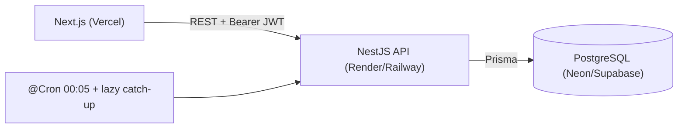
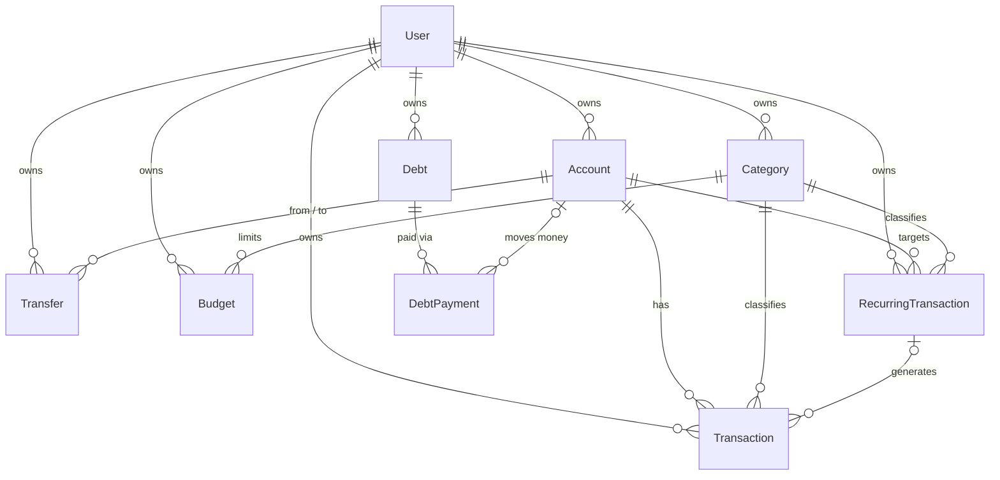

# MONEYBOOK

Ứng dụng quản lý tài chính cá nhân: ghi thu/chi, chuyển tiền giữa ví, ngân sách theo tháng, sổ nợ, giao dịch định kỳ, dashboard và báo cáo. Được xây như một dự án portfolio với trọng tâm là **tính toàn vẹn của số dư**.

## 1. Project overview

| | |
|---|---|
| Mục tiêu | Dùng hằng ngày để theo dõi tiền + minh họa business logic tài chính đúng đắn |
| Điểm nhấn kỹ thuật | Balance engine nguyên tử (DB transaction), Decimal chính xác, cách ly dữ liệu theo user, catch-up giao dịch định kỳ idempotent |
| Ngôn ngữ giao diện | Tiếng Việt (VND) |

## 2. Features

- Tài khoản/ví: tiền mặt, ngân hàng, ví điện tử, thẻ tín dụng; tạo/sửa/tắt/xóa an toàn
- Thu, chi, **chuyển tiền** (cập nhật số dư cả hai ví trong một transaction)
- Danh mục tùy chỉnh (có sẵn 5 thu + 10 chi cho user mới)
- Lịch sử giao dịch: tìm kiếm, lọc (ngày/ví/danh mục/loại), sắp xếp, phân trang
- Ngân sách tháng theo danh mục: cảnh báo ≥ 80%, trạng thái vượt ngân sách
- Sổ nợ (cho vay/đi vay), ghi nhận trả nợ từng đợt (tùy chọn ghi vào ví)
- Giao dịch định kỳ (ngày/tuần/tháng/năm) với bù các kỳ bị lỡ
- Dashboard (4 biểu đồ) và báo cáo: tháng, danh mục, dòng tiền, tài sản ròng; chọn khoảng thời gian
- Responsive, thanh điều hướng dưới + nút `+` nổi trên mobile

## 3. Architecture

```text
moneybook/
├── apps/
│   ├── api/   NestJS REST API (Prisma, JWT, Swagger)
│   └── web/   Next.js (App Router) client
├── docker-compose.yml
└── .github/workflows/ci.yml
```



Các quyết định quan trọng:

1. **Balance engine** (`apps/api/src/common/balance.ts`): nơi *duy nhất* thay đổi `Account.balance`, dùng `increment` nguyên tử trong `prisma.$transaction`. Bản ghi giao dịch và số dư cùng commit hoặc cùng rollback.
2. **Transfer là bảng riêng**: chuyển tiền không phải thu/chi nên không làm sai báo cáo.
3. **Tiền là `Decimal(19,2)`**, truyền qua API dưới dạng *chuỗi*, không bao giờ qua `float`.
4. **Cách ly dữ liệu**: mọi query có `userId`; truy cập dữ liệu người khác trả `404` (không lộ sự tồn tại). JWT guard bật toàn cục, route công khai phải đánh dấu `@Public()`.
5. **Ngày là `@db.Date`** + múi giờ `Asia/Ho_Chi_Minh` cho "hôm nay" → không lệch ngày.
6. **Recurring idempotent**: mỗi kỳ được "claim" bằng `updateMany where nextRunAt = X`; hai lần chạy song song không tạo trùng. Dashboard tự chạy catch-up cho user (host free tier có thể ngủ làm lỡ cron).
7. **`GET /accounts/:id/reconcile`** tính lại số dư từ lịch sử để chứng minh số dư lưu sẵn không bị lệch.

## 4. Tech stack

Frontend: Next.js 15, TypeScript (strict), Tailwind CSS v4, shadcn/ui-style components (Radix), React Hook Form, Zod, TanStack Query, Recharts.
Backend: NestJS 11, Prisma 6, PostgreSQL 16, JWT (passport-jwt), argon2, class-validator, Swagger.
Infra: Docker, Docker Compose, GitHub Actions.

## 5. Database diagram



Schema đầy đủ (kiểu dữ liệu, index, foreign key): [`apps/api/prisma/schema.prisma`](apps/api/prisma/schema.prisma).

## 6. API documentation

Swagger UI: `http://localhost:3001/docs` (nút **Authorize** để dán JWT). Tất cả response: `{ "success": true, "data": … }` hoặc `{ "success": false, "statusCode", "message", "errors?" }`.

| Nhóm | Endpoint |
|---|---|
| Auth | `POST /auth/register` · `POST /auth/login` · `GET /auth/me` |
| Accounts | `GET/POST /accounts` · `GET/PATCH/DELETE /accounts/:id` · `GET /accounts/:id/reconcile` |
| Categories | `GET/POST /categories` · `PATCH/DELETE /categories/:id` |
| Transactions | `GET/POST /transactions` · `GET/PATCH/DELETE /transactions/:id` |
| Transfers | `GET/POST /transfers` · `DELETE /transfers/:id` |
| Budgets | `GET/POST /budgets` · `PATCH/DELETE /budgets/:id` |
| Debts | `GET/POST /debts` · `GET/PATCH/DELETE /debts/:id` · `POST /debts/:id/payments` |
| Recurring | `GET/POST /recurring` · `POST /recurring/run` · `PATCH/DELETE /recurring/:id` |
| Reports | `GET /reports/monthly` · `/categories` · `/cash-flow` · `/net-worth` (`?range=this_month\|last_month\|last_3_months\|last_6_months\|this_year\|custom&from&to`) |
| Dashboard | `GET /dashboard` |
| Health | `GET /health` |

## 7. Environment variables

`apps/api/.env`

| Biến | Mô tả |
|---|---|
| `DATABASE_URL` | Chuỗi kết nối cho app lúc chạy (Supabase: Transaction pooler, cổng 6543, có `?pgbouncer=true`) |
| `DIRECT_URL` | Chuỗi kết nối cho Prisma CLI: migrate/seed (Supabase: Session pooler, cổng 5432). Chạy local thì đặt giống `DATABASE_URL` |
| `JWT_SECRET` | Bí mật ký JWT, **≥ 32 ký tự** (app không khởi động nếu thiếu) |
| `JWT_EXPIRES_IN` | Hạn token, mặc định `1d` |
| `CORS_ORIGIN` | Origin của web, nhiều giá trị cách nhau bằng dấu phẩy |
| `PORT` | Mặc định `3001` |

`apps/web/.env.local`: `NEXT_PUBLIC_API_URL` (URL API, được nhúng lúc build).

## 8. Local setup

Yêu cầu: Node ≥ 20, Docker.

```bash
npm install
cp .env.example .env
cp apps/api/.env.example apps/api/.env          # đổi JWT_SECRET
cp apps/web/.env.example apps/web/.env.local
npm run db:up                                    # Postgres bằng Docker
npm run db:generate
npm run db:migrate -- --name init                # tạo bảng + sinh thư mục prisma/migrations (hãy commit nó)
npm run db:seed                                  # dữ liệu demo
npm run dev:api                                  # http://localhost:3001  (docs: /docs)
npm run dev:web                                  # http://localhost:3000
```

Đăng nhập demo: `demo@moneybook.app` / `Demo123!` (4 ví, 12+ danh mục, 36+ giao dịch, 3 ngân sách, 2 khoản nợ, 2 giao dịch định kỳ).

**Database constraints (khuyến nghị):** sau migration `init`, thêm ràng buộc `CHECK` làm lớp bảo vệ thứ hai:

```bash
cd apps/api
npx prisma migrate dev --create-only --name add_checks
# dán nội dung prisma/constraints.sql vào file migration vừa tạo, rồi:
npx prisma migrate dev
```

## 8b. Dùng Supabase làm database

1. Supabase → **New project** (lưu lại Database Password; ký tự đặc biệt phải URL-encode: `@`→`%40`, `#`→`%23`).
2. Nhấn **Connect** trên dashboard, lấy 2 chuỗi:

```env
# apps/api/.env
DATABASE_URL="postgresql://postgres.<ref>:<password>@aws-0-<region>.pooler.supabase.com:6543/postgres?pgbouncer=true"
DIRECT_URL="postgresql://postgres.<ref>:<password>@aws-0-<region>.pooler.supabase.com:5432/postgres"
```

| Biến | Chuỗi Supabase | Vì sao |
|---|---|---|
| `DATABASE_URL` | Transaction pooler (6543) + `pgbouncer=true` | App chạy lâu dài/serverless dùng pool; `pgbouncer=true` tắt prepared statements mà pooler không hỗ trợ |
| `DIRECT_URL` | Session pooler (5432) hoặc Direct connection | `prisma migrate` cần kết nối không qua transaction pooler |

> Direct connection của Supabase mặc định chỉ có IPv6. Mạng IPv4 (nhiều nhà mạng, một số CI) sẽ báo lỗi `P1001` → dùng **Session pooler** cho `DIRECT_URL`.

3. Tạo bảng và seed (bỏ qua `db:up`, không cần Docker database):

```bash
npm run db:generate
npm run db:migrate -- --name init     # chạy qua DIRECT_URL
npm run db:seed                       # tùy chọn: dữ liệu demo
```

4. **Bảo mật, bắt buộc:** chạy `apps/api/prisma/supabase-rls.sql` trong *SQL Editor*. Supabase tự mở các bảng ở schema `public` ra REST Data API bằng anon key; bảng do Prisma tạo không bật RLS nên ai có anon key đều đọc/ghi được, bỏ qua mọi kiểm tra của API. Bật RLS (không policy) chặn đường đó, còn API không bị ảnh hưởng vì Prisma kết nối bằng role `postgres`.
5. Deploy: đặt cả `DATABASE_URL` và `DIRECT_URL` trên Render/Railway (container API chạy `prisma migrate deploy` khi khởi động nên cần cả hai).
6. Chạy Docker full-stack mà không dùng container DB: điền `DATABASE_URL`, `DIRECT_URL` vào `.env` rồi `docker compose up --build api web`.

Lưu ý: không dùng Supabase Auth/Storage, chỉ dùng như PostgreSQL; đăng nhập do API xử lý. Free project có thể bị tạm dừng sau thời gian không hoạt động.

## 9. Docker setup

```bash
cp .env.example .env          # điền JWT_SECRET
docker compose up --build     # db + api + web
```

Web: http://localhost:3000 · API: http://localhost:3001/docs. Container API tự chạy `prisma migrate deploy` khi khởi động (hoặc `db push` nếu chưa có thư mục migrations). Seed demo: `docker compose exec api npx tsx prisma/seed.ts`.

## 10. Testing

```bash
npm test            # 54 test, không cần database
npm run typecheck && npm run lint
```

| Nhóm | Nội dung |
|---|---|
| Balance engine | Thu, chi, sửa/xóa giao dịch, **Transfer 1.000.000 (5.000.000→4.000.000 / 500.000→1.500.000)**, không dùng float (0.10 + 0.20 = 0.30) |
| Rollback | Lỗi giữa chừng khi transfer/tạo giao dịch → số dư và bản ghi về nguyên trạng |
| Data isolation | User B không đọc/sửa/xóa/dùng ví, danh mục, chuyển tiền của user A (404) |
| Budget / Net worth / Savings | Công thức, ngưỡng cảnh báo, tài sản − nợ |
| Dates | Kỳ định kỳ (ngày 31 không bị trôi), khoảng báo cáo, múi giờ VN |
| HTTP | Guard 401, validation, từ chối thuộc tính thừa, OpenAPI |

Các test balance dùng một "database giả trong bộ nhớ" có snapshot/rollback thật (`src/testing/fake-prisma.ts`). Nên bổ sung integration test với PostgreSQL thật (xem roadmap).

## 11. Deployment

1. **Database (Supabase):** xem mục 8b (hai chuỗi kết nối + bật RLS).
2. **API (Render/Railway):** Docker deploy với `apps/api/Dockerfile` (build context = root repo), hoặc Node: build `npm ci && npx prisma generate --schema apps/api/prisma/schema.prisma && npm run build -w apps/api`, start `cd apps/api && npx prisma migrate deploy && node dist/main`. Đặt `DATABASE_URL`, `JWT_SECRET`, `CORS_ORIGIN=https://<web>.vercel.app`.
3. **Web (Vercel):** import repo, *Root Directory* = `apps/web`, biến `NEXT_PUBLIC_API_URL=https://<api-host>`.
4. Kiểm tra `GET /health`, rồi đăng ký tài khoản.

Lưu ý free tier: API có thể "ngủ"; giao dịch định kỳ vẫn được bù khi mở dashboard hoặc bấm *Chạy ngay*.

## 12. Screenshots

Thêm ảnh vào `docs/screenshots/` (dashboard, transactions, budgets, reports, mobile) và nhúng tại đây:

```md

```

## 13. Future roadmap

- Integration test với PostgreSQL thật (Testcontainers) cho rollback/đồng thời
- Refresh token + httpOnly cookie, rate limiting đăng nhập
- Đa tiền tệ + tỷ giá; biểu đồ tài sản ròng theo thời gian
- Import/export CSV, đính kèm hóa đơn
- Giao dịch chia nhỏ (split), thẻ (tags), mục tiêu tiết kiệm
- i18n (thông báo lỗi API hiện bằng tiếng Anh), dark mode, PWA
